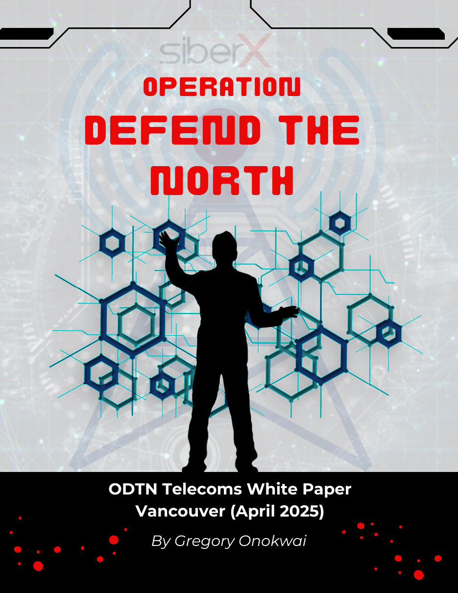
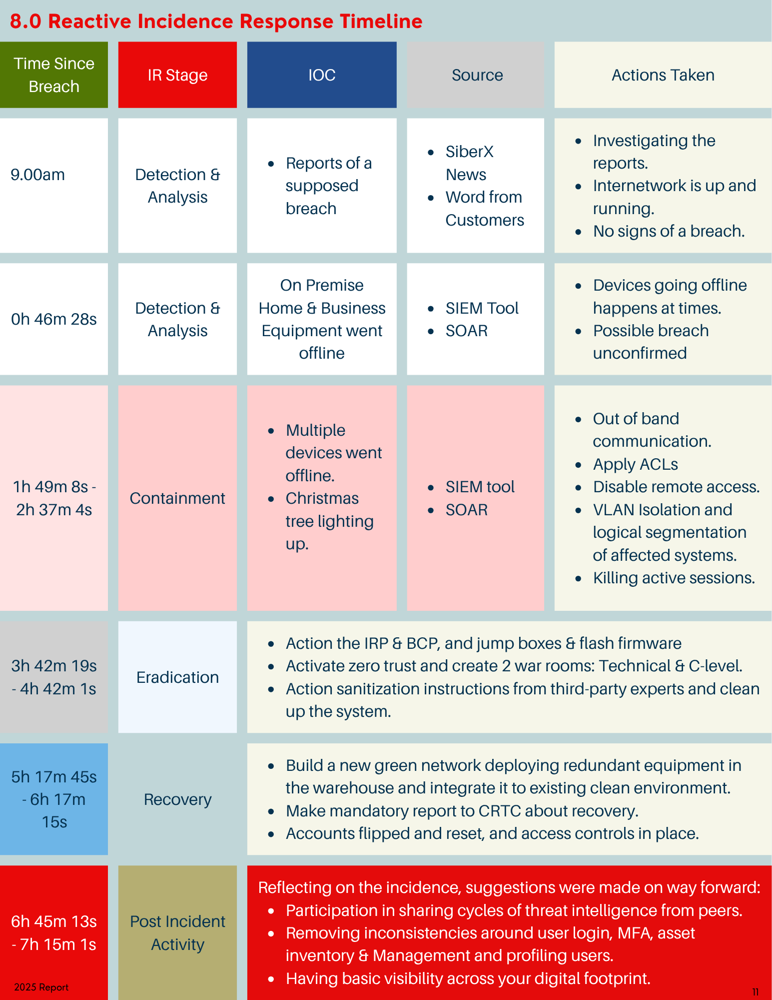

# Operation Defend the North: Incident Response White Paper

**A 14-page incident response white paper analysing a simulated nationwide cyberattack on a Canadian telecom provider, from first warning signs to full recovery in 7 hours 15 minutes.**

📄 **[Read the full white paper (PDF)](Operation_Defend_the_North_Incident_Response_White_Paper.pdf)**

  

---

## Table of Contents

1. [Overview](#overview)
2. [The Scenario](#the-scenario)
3. [Key Figures](#key-figures)
4. [Approach and Framework](#approach-and-framework)
5. [Incident Response Timeline](#incident-response-timeline)
6. [Real-World Case Studies](#real-world-case-studies)
7. [Key Recommendations](#key-recommendations)
8. [What's Inside the White Paper](#whats-inside-the-white-paper)
9. [Skills Demonstrated](#skills-demonstrated)
10. [Disclaimer](#disclaimer)
11. [Author](#author)

---

## Overview

Telecom networks carry emergency calls, banking, healthcare and government services. When they go down, the whole country feels it.

This white paper is based on **SiberX's Operation Defend the North 2025: Vancouver**, a simulated national cyber-crisis exercise. It documents how the fictional **ODTN Telecom** detected, contained, removed and recovered from a sophisticated attack. It then compares each response stage with real incidents such as the **2022 Rogers outage**, **SolarWinds** and **NotPetya**.

The paper answers three questions:

1. **What happened**, and how was the attack detected?
2. **How did the response team contain and remove it**, and how were services restored?
3. **What should telecoms, regulators and governments change** to prevent the next one?

---

## The Scenario

On **April 16, 2025**, customers in the Vancouver area began reporting lost wireless and internet service. Within hours, the outage spread nationwide.

The investigation traced the **root cause** to:

- a **malicious firmware update**
- pushed through a **compromised management server**
- that was protected only by **weak SSH keys**.

The attack showed serious weaknesses in both **operational infrastructure** and **supply chain security**. The attacker profile resembled advanced persistent threat (APT) groups such as **Salt Typhoon**.

---

## Key Figures

| Metric | Value |
|---|---|
| Total time to resolve the breach | **7h 15m** |
| Estimated national economic impact (simulated) | **$46,760,249** |
| Response stages documented | **5** (NIST incident response lifecycle) |
| Real-world incidents analysed | **5** |

---

## Approach and Framework

The response is structured around the **NIST incident response lifecycle** (SP 800-61), with one module per stage:

| Module | Stage | What the team did |
|---|---|---|
| 1 | **Detection & Analysis** | Spotted early warning signs (customer reports, offline equipment on SIEM/SOAR dashboards), defined scope and origin, and set up out-of-band communication |
| 2 | **Containment** | Isolated and segmented the network (VLANs), disabled remote access, ended active sessions, and activated the business continuity and incident response plans |
| 3 | **Eradication** | Traced the malicious firmware through log analysis, factory-reset and reimaged affected nodes, ran rootkit scans, and applied ACLs to stop lateral movement |
| 4 | **Recovery** | Built a new clean ("green") network, checked system integrity with checksums and kernel module checks, and reset all accounts |
| 5 | **Post-Incident Activity** | Recommended MFA, bastion hosts, privileged access management, tabletop exercises and threat-intelligence sharing |

Each stage is also mapped to core security principles: **Zero Trust**, **supply chain security**, **crisis management**, **data privacy** and **cyber resilience**.

---

## Incident Response Timeline

The paper includes a minute-by-minute response timeline, from the first customer reports to the post-incident review.

  

---

## Real-World Case Studies

Each response stage is compared with a real incident:

| Stage | Incident | Lesson |
|---|---|---|
| Detection & Analysis | **Optus outage** (Australia, 2023) | Slow, vague communication damaged customer trust |
| Containment | **Colonial Pipeline** ransomware (US, 2021) | Shutting down early and separating IT from OT limited the damage |
| Eradication | **NotPetya / Maersk** (global, 2017) | Systems had to be rebuilt from scratch using one surviving domain controller |
| Recovery | **Rogers outage** (Canada, 2022) | Phased restoration and a mutual-assistance agreement between Canadian telecoms |
| Post-Incident | **SolarWinds** supply chain attack (2020) | Stronger requirements for code integrity and third-party audits |

---

## Key Recommendations

- **Prevent:** adopt Zero Trust, micro-segmentation, MFA, bastion (jump) hosts and privileged access management.
- **Detect:** automate log monitoring so SOC analysts have time for threat hunting, and profile users against their peers, not just their own history.
- **Prepare:** run regular tabletop exercises and keep tested incident response, business continuity and disaster recovery plans.
- **Collaborate:** improve teamwork between the SOC and NOC, and share threat intelligence with industry peers.
- **Govern:** introduce mandatory outage reporting, redundancy requirements and a national telecom resilience framework.

---

## What's Inside the White Paper

1. Executive Summary
2. Introduction and Threat Landscape
3. Background: Network Architecture, Security Posture, Canadian Regulatory Environment
4. Response Modules 1–5
5. Mapping to Cybersecurity Principles
6. Real-World Incidents and Expert Quotes
7. Cross-Discipline Insights: Telecom Infrastructure, Law & Policy, Public Sector, Frameworks
8. Incident Response Timeline
9. References

---

## Skills Demonstrated

- Incident response planning across the full NIST lifecycle
- Root cause analysis and threat analysis (APT and supply chain attacks)
- Network security concepts: segmentation, VLANs, ACLs, Zero Trust
- Knowledge of Canadian regulators and bodies (CRTC, Canadian Centre for Cyber Security, CCTX)
- Case study research and comparison
- Technical writing and executive-level communication

---

## Disclaimer

**ODTN Telecom and the incident described are fictional.** They come from a simulated exercise (SiberX Operation Defend the North 2025: Vancouver). All figures, including the economic impact and response times, are simulated. The real-world incidents referenced are drawn from publicly available sources listed in the paper.

---

## Author

**Gregory Onokwai**: Data Analyst | Diploma in Cybersecurity, ABM College

- Portfolio: [gregoryonokwai.github.io](https://gregoryonokwai.github.io)
- LinkedIn: [linkedin.com/in/gregory-onokwai](https://www.linkedin.com/in/gregory-onokwai)
- GitHub: [@GregoryOnokwai](https://github.com/GregoryOnokwai)
