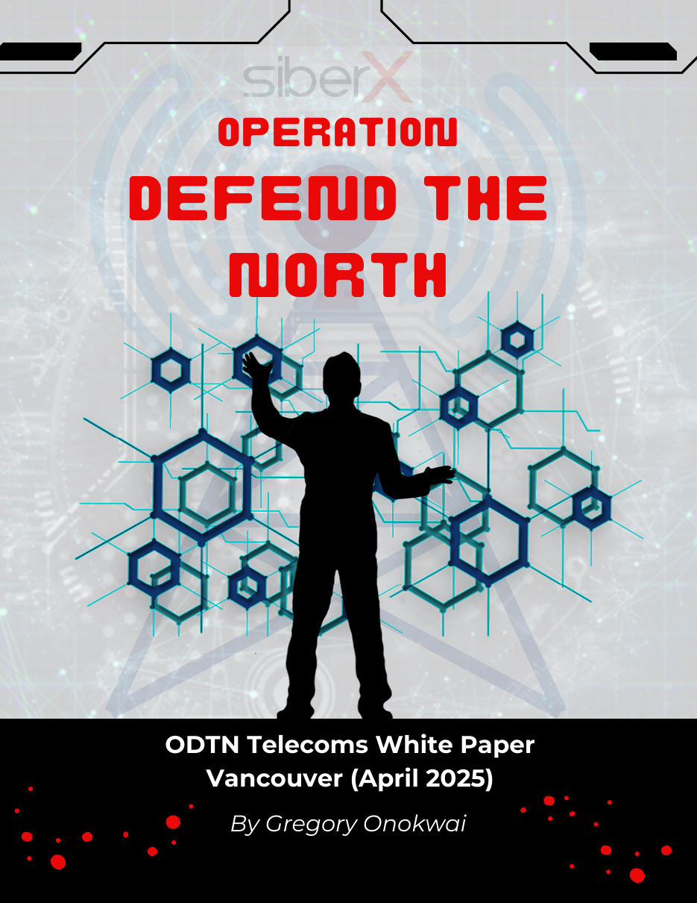
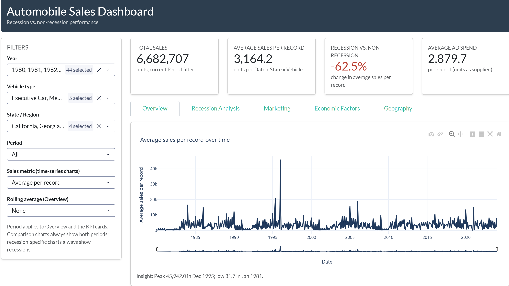

A selection of data analysis, visualization and cybersecurity projects. Each project links to a live demo and its source code on GitHub.

---

## Operation Defend the North: Incident Response White Paper

{width="45%"}

A 14-page white paper analysing a simulated nationwide cyberattack on a Canadian telecom provider,
based on SiberX's Operation Defend the North 2025 (Vancouver) exercise. It follows the response
through the five NIST incident response stages, from detection to post-incident review, and
compares each stage with real incidents including the Rogers outage, SolarWinds and NotPetya.
**Key result:** full recovery in **7h 15m** after a malicious firmware update caused a national blackout.

**Skills:** Incident Response · NIST SP 800-61 · Zero Trust · Root Cause Analysis · Technical Writing

[Read the White Paper](https://github.com/GregoryOnokwai/incident-response-white-paper/blob/main/Operation_Defend_the_North_Incident_Response_White_Paper.pdf){.btn .btn-primary target="_blank"}
[View on GitHub](https://github.com/GregoryOnokwai/incident-response-white-paper){.btn .btn-outline-primary target="_blank"}

---

## Automobile Sales Performance Across Economic Cycles

Interactive Plotly Dash dashboard analysing 44 years of US automobile sales (1980–2023).
It compares recession and non-recession periods and links sales to advertising,
seasonality, GDP, unemployment and consumer confidence.
**Key finding:** average sales per record fall **62.5%** during recessions.

**Tools:** Python · Plotly Dash · pandas · statsmodels · Render

[Live Dashboard](https://automobile-sales-dashboard-n4wl.onrender.com){.btn .btn-primary target="_blank"}
[View Code](https://github.com/GregoryOnokwai/automobile-sales-dashboard){.btn .btn-outline-primary target="_blank"}